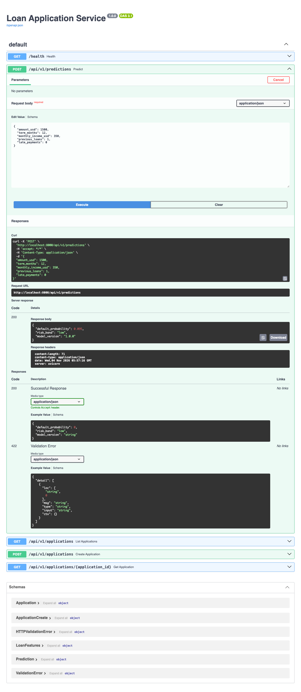

# Production image checklist — `loan-api:1.0.0`

Image built from `Dockerfile.prod` with `docker compose build` (or `docker build -f Dockerfile.prod -t loan-api:1.0.0 .`).
Evidence below was captured on 2026-11-04 with Docker 29.8.0.

---

## 1. Small, pinned base image

`Dockerfile.prod` uses `python:3.12.16-slim` (an exact Python version on Debian slim, not `latest`).

```
$ grep FROM Dockerfile.prod
FROM python:3.12.16-slim AS builder
FROM python:3.12.16-slim

$ docker images loan-api:1.0.0
IMAGE            ID             DISK USAGE   CONTENT SIZE
loan-api:1.0.0   728719c82817        799MB          169MB
```

Most of the size is scikit-learn, SciPy, pandas and NumPy (the `/opt/venv` layer); the slim base is about 160 MB.

## 2. Multi-stage build

Stage `builder` installs dependencies into `/opt/venv` and trains the model. The final stage copies only the venv, the model file and the two app files — no compilers, no build cache, no `train.py`.

```
$ docker history loan-api:1.0.0 --format "table {{.CreatedBy}}\t{{.Size}}"
CMD ["uvicorn" "main:app" "--host" "0.0.0.0"…   0B
HEALTHCHECK {Test:[CMD python -c import urll…   0B
EXPOSE [8000/tcp]                               0B
USER app                                        0B
COPY --chown=app:app main.py schemas.py ./      16.4kB
COPY --chown=app:app /build/models /app/mode…   16.4kB
COPY /opt/venv /opt/venv # buildkit             ~470MB
WORKDIR /app                                    8.19kB
RUN groupadd --system --gid 10001 …             41kB
...(python:3.12.16-slim base layers)

$ docker run --rm loan-api:1.0.0 ls /app
main.py
models
schemas.py
```

## 3. Runs as a non-root user

```
$ docker image inspect loan-api:1.0.0 --format "User={{.Config.User}}"
User=app

$ docker run --rm loan-api:1.0.0 id
uid=10001(app) gid=10001(app) groups=10001(app)
```

## 4. Production dependencies only

`requirements.txt` holds runtime packages; `requirements-dev.txt` adds `pytest` and is used only by the dev `Dockerfile` and the Codespace. `pip` itself is also removed from the runtime venv.

```
$ cat requirements-dev.txt
-r requirements.txt
pytest==9.1.1

$ docker run --rm loan-api:1.0.0 python -c "import pytest"
ModuleNotFoundError: No module named 'pytest'
```

## 5. No secrets in the image; `.dockerignore` keeps the context clean

`.dockerignore` excludes `.git`, `.env*`, keys, virtualenvs, caches, the local `model.joblib` and Docker/Compose files. The prod image copies files by name (`main.py schemas.py`), never `COPY . .`.

```
$ docker history --no-trunc loan-api:1.0.0 --format "{{.CreatedBy}}" | grep -iE "password|secret|token|api_key" || echo "no secrets in layer history"
no secrets in layer history

$ docker run --rm -v /var/run/docker.sock:/var/run/docker.sock aquasec/trivy image --scanners secret loan-api:1.0.0
(no secrets found)

$ grep -rniE "password|secret|token|api_key" --exclude-dir=.git .
compose.yaml:11:      DATABASE_URL: postgresql://loan:loan_dev_password@db:5432/loans
compose.yaml:21:      POSTGRES_PASSWORD: loan_dev_password   # development only - never use in production
```

The only match is the development-only database password in `compose.yaml` (the allowed exception). It is not in the image.

## 6. Health check and configurable model path

The image declares a `HEALTHCHECK` that calls `/health`, and `main.py` reads `MODEL_PATH` from the environment (default `model.joblib`; the image sets `/app/models/model.joblib`).

```
$ docker image inspect loan-api:1.0.0 --format "{{json .Config.Healthcheck}}"
{"Test":["CMD","python","-c","import urllib.request; urllib.request.urlopen('http://localhost:8000/health', timeout=2)"],"Interval":30000000000,"Timeout":3000000000,"StartPeriod":10000000000,"Retries":3}

$ docker compose up -d --build
$ docker compose ps
SERVICE   IMAGE                STATUS                    PORTS
api       loan-api:1.0.0       Up 20 seconds (healthy)   0.0.0.0:8000->8000/tcp
db        postgres:17-alpine   Up 26 seconds (healthy)   5432/tcp

$ curl -s localhost:8000/health
{"status":"ok","model_version":"1.0.0"}

$ curl -s -X POST localhost:8000/api/v1/predictions -H "Content-Type: application/json" \
    -d '{"amount_usd":1500,"term_months":12,"monthly_income_usd":350,"previous_loans":1,"late_payments":0}'
{"default_probability":0.095,"risk_band":"low","model_version":"1.0.0"}
HTTP 200

$ docker compose exec db psql -U loan -d loans -c "\dt"
 public | applications | table | loan      <- created by init.sql
```

## 7. Vulnerability scan (Trivy): no fixable HIGH/CRITICAL findings

```
$ docker run --rm -v /var/run/docker.sock:/var/run/docker.sock aquasec/trivy \
    image --scanners vuln,secret --severity HIGH,CRITICAL loan-api:1.0.0

loan-api:1.0.0 (debian 13.7)   Total: 45 (HIGH: 45, CRITICAL: 0)
Python (python-pkg)            Total: 0  (HIGH: 0,  CRITICAL: 0)
Secrets                        none
```

**CRITICAL: 0.** Notes on each HIGH finding:

| Finding | Package(s) | Status | Note |
|---|---|---|---|
| CVE-2025-47273 | setuptools 70.3.0 (Python) | **Rebuilt and fixed** | Reported from the SBOM vendored inside `pip`. `pip` is not needed at runtime, so `Dockerfile.prod` now runs `pip uninstall -y pip` in the venv. Rescan: 0 Python findings. |
| CVE-2026-76642, CVE-2026-78408, CVE-2026-78409, CVE-2026-78410 | util-linux family: `util-linux`, `mount`, `login`, `bsdutils`, `libblkid1`, `libmount1`, `libsmartcols1`, `libuuid1`, `liblastlog2-2` | Cannot fix yet | Debian 13 has no fixed version ("affected"). These concern `mount`/`nsenter`, which the API never runs, and the container runs as non-root. |
| CVE-2025-69720 | ncurses: `ncurses-base`, `ncurses-bin`, `libncursesw6`, `libtinfo6` | Cannot fix yet | No Debian fix released. Terminal library, not used by the API. |
| CVE-2026-54369 | `libacl1` | Cannot fix yet | No Debian fix released. Base-OS library. |
| CVE-2026-119373 | `libsqlite3-0` | Cannot fix yet | No Debian fix released. The API does not use SQLite. |
| CVE-2026-16742 | `libsystemd0`, `libudev1` | Cannot fix yet | No Debian fix released. systemd does not run in the container. |
| CVE-2026-9538 | `perl-base` | Cannot fix yet | Debian marked it "fix_deferred". Affects Perl's Archive::Tar, never called by the API. |

Plan: rebuild with `docker build --pull` when Debian publishes fixes, then rescan.

---

## Publish to Docker Hub

```
$ docker login
$ docker tag loan-api:1.0.0 semsethy/loan-api:1.0.0
$ docker tag loan-api:1.0.0 semsethy/loan-api:latest
$ docker push semsethy/loan-api:1.0.0
$ docker push semsethy/loan-api:latest
1.0.0: digest: sha256:728719c82817f9449cc06e4d1d6ee6e019a8a0f895997ee3ea3a3496d1726140 size: 856
latest: digest: sha256:728719c82817f9449cc06e4d1d6ee6e019a8a0f895997ee3ea3a3496d1726140 size: 856

$ curl -s https://hub.docker.com/v2/repositories/semsethy/loan-api/tags | jq -r '.results[].name'
latest
1.0.0
```

Repository: https://hub.docker.com/r/semsethy/loan-api (tags `1.0.0` and `latest`).

## Pull and run from the registry (no local files)

```
$ docker compose down
$ docker rmi loan-api:1.0.0 semsethy/loan-api:1.0.0 semsethy/loan-api:latest
Untagged: loan-api:1.0.0
Untagged: semsethy/loan-api:1.0.0
Untagged: semsethy/loan-api:latest
Deleted: sha256:728719c82817f9449cc06e4d1d6ee6e019a8a0f895997ee3ea3a3496d1726140

$ docker images | grep loan-api || echo "no local loan-api images"
no local loan-api images

$ docker run --rm -p 8000:8000 semsethy/loan-api:1.0.0
1.0.0: Pulling from semsethy/loan-api
Status: Downloaded newer image for semsethy/loan-api:1.0.0

$ curl -s -X POST localhost:8000/api/v1/predictions -H "Content-Type: application/json" \
    -d '{"amount_usd":1500,"term_months":12,"monthly_income_usd":350,"previous_loans":1,"late_payments":0}'
{"default_probability":0.095,"risk_band":"low","model_version":"1.0.0"}   HTTP 200
```

Screenshot of `/docs` with the 200 prediction response from the pulled image:


